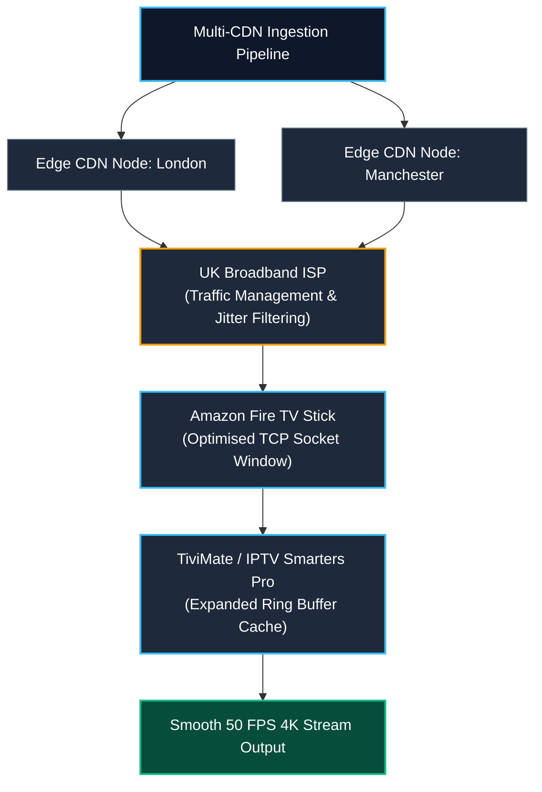

# Fire TV Stick IPTV Buffer Tuning & ADB Optimisation Guide

Technical buffer configurations, ADB shell memory management scripts, and cache optimisation parameters for IPTV Smarters Pro and TiviMate on Amazon Fire TV Stick devices.

---

## Technical Overview

Amazon Fire OS applies conservative Linux kernel network defaults across Fire TV Stick 4K, 4K Max, and Cube devices. With physical RAM constrained to 1.5 GB or 2 GB, the stock Android low-memory killer (LMK) and TCP socket buffers often throttle incoming MPEG-TS and HLS media segments during high-bitrate live video playback.

When combined with peak-time packet inspection from [UK broadband ISP traffic management](https://bestiptvuk.vg/iptv-providers/internet-isps/), these device-level constraints produce micro-stuttering, audio desynchronisation, and playback loop freezes.

This repository provides reproducible ADB (Android Debug Bridge) terminal scripts and in-app buffer parameters designed to expand hardware network sockets, suppress background memory reclamation, and eliminate playback interruptions.

---

## 1. ADB Shell Kernel Network Tuning

Connecting to your Fire TV Stick over local ADB allows you to adjust the Linux TCP receive window (`tcp_rmem`) and socket memory allocations. This gives the streaming player sufficient headroom to absorb network jitter.

### Enabling ADB Debugging
1. Navigate to **Settings > My Fire TV > About**.
2. Highlight your device name and click the **Select** button 7 times until Developer Options become enabled.
3. Open **Developer Options** and set **ADB Debugging** to **ON**.
4. Check **Settings > My Fire TV > About > Network** to note your local IP address (e.g. `192.168.1.85`).

### Connecting from Terminal
Connect from your desktop or local terminal:

```bash
adb connect 192.168.1.85:5555
```

### Buffer Expansion Script (`tune_buffer.sh`)
Execute the following commands to increase TCP receive window buffers and network memory limits:

```bash
# Expand TCP receive buffer allocations (min / default / max in bytes)
adb shell su 0 setprop net.tcp.buffersize.wifi "524288,1048576,2097152,524288,1048576,2097152"

# Increase global socket read buffer allocation
adb shell settings put global tcp_default_init_rwnd 60

# Prevent Fire OS from killing the active IPTV player during background sync
adb shell cmd deviceidle whitelist +ar.tvplayer.tv
adb shell cmd deviceidle whitelist +com.nst.iptvsmarterstvbox
```

*Note: System property changes via `setprop` reset on hardware reboot. To make them persistent across reboots without root, run the tuning commands as an automated shell script whenever the device connects.*

---

## 2. TiviMate Buffer Configuration

TiviMate utilises Google's ExoPlayer media engine. While efficient, ExoPlayer's default buffer on Fire OS holds less than 2 seconds of video in memory, making it vulnerable to transport stream drops.

### Recommended Playback Settings
* **Buffer Size:** Set to **Large** or **Very Large**.
  * *Path:* `Settings > Playback > Buffer size > Very Large`
  * *Effect:* Expands the ring buffer to 10-15 seconds of raw TS segments, providing a substantial absorption cushion against ISP traffic shaping.
* **Audio Decoder:** Set to **Hardware**.
  * *Path:* `Settings > Playback > Audio decoder > Hardware`
  * *Effect:* Offloads audio processing to the SoC DSP, saving CPU cycles for video packet reassembly.
* **A/V Sync Offset:** `0 ms` (Use hardware auto-frame rate matching if your television supports 50 Hz refresh rates).
* **Tunneled Playback:** Set to **ON** on Fire TV Stick 4K Max (2nd Gen) to enable direct hardware video rendering through the MediaCodec pipeline.

---

## 3. IPTV Smarters Pro Buffer Configuration

IPTV Smarters Pro relies on a dual-engine architecture: an embedded VLC build and a standard Android MediaPlayer backend.

### Recommended Player Settings
* **Player Selection:**
  * Live Streams: Switch from **Native** to **Built-in Player (VLC)**.
  * *Path:* `Settings > Player Selection > Built-in Player (VLC)`
  * *Effect:* VLC's demuxer handles non-standard MPEG-TS packet headers far better than standard Android MediaPlayer.
* **Stream Format:**
  * Switch stream type from **MPEG-TS (.ts)** to **HLS (.m3u8)**.
  * *Path:* `Settings > Stream Format > HLS`
  * *Effect:* HLS streams download chunked media segments over standard HTTP/HTTPS ports, which pass through ISP inspection filters more reliably during high-concurrency events.
* **Hardware Acceleration:** Set to **Full Acceleration** to minimise thermal throttling on Fire Stick HDMI dongles.

---

## 4. Hardware Maintenance & Cache Purge

Accumulated cache files from thumbnails and EPG updates frequently exhaust the low-capacity eMMC flash storage on Fire TV devices, choking I/O operations.

### Automated ADB Cache Clean Script

```bash
#!/bin/bash
# Clear accumulated EPG and thumbnail cache without losing user logins

echo "Purging TiviMate temporary cache..."
adb shell pm trim-caches 100M

echo "Cleaning IPTV Smarters temporary runtime storage..."
adb shell rm -rf /sdcard/Android/data/com.nst.iptvsmarterstvbox/cache/*

echo "Current available disk storage on Fire TV:"
adb shell df -h /data
```

---

## 5. Network Architecture & Server-Side Anti-Freeze

Local buffer tuning optimises the receiving endpoint, but zero-buffering performance ultimately depends on how the media stream is delivered across Tier-1 internet transit networks.

Modern streaming infrastructures developed by [Best IPTV UK](https://bestiptvuk.vg/) pair these client-side configurations with multi-CDN [anti-freeze technology](https://bestiptvuk.vg/iptv-providers/anti-freeze-technology/). This multi-layered architecture dynamically redistributes traffic across redundant data centres whenever local UK exchange points encounter packet drops or congestion.



---

## Contributing

Pull requests with additional ADB profiling scripts, hardware benchmarks, and network configurations for other Fire OS versions are welcome.

## Licence

MIT Licence. See [LICENCE](LICENCE) for details.
